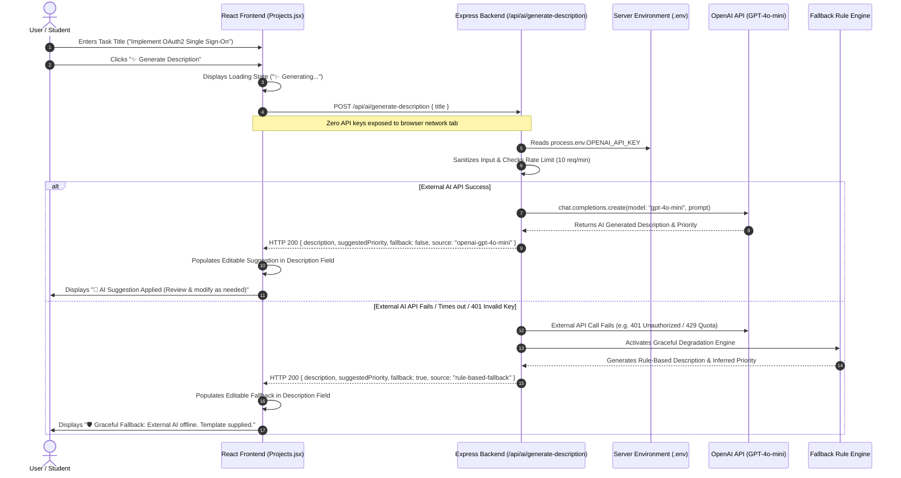

# ADVANCED WEB DEVELOPMENT FRAMEWORKS (ITUE301)
## Practical 13: AI API Integration into a Web Application

**Course Outcome (CO):** CO6  
**Program Outcomes (PO):** PO3, PO5, PO12  
**Objective:** To integrate an external AI service into the full-stack Task Management application, implement responsible AI practices, enforce secure server-side key management, and guarantee graceful degradation upon third-party API failures.  
**Repository:** [https://github.com/riyakakkad/AWDF.git](https://github.com/riyakakkad/AWDF.git)  

---

## 1. Architecture & Data Flow Diagram



---

## 2. Problem Statement & Core Requirements

1. **AI-Powered Feature:** Add an intelligent assistant feature to the Task Management application that analyzes a task title and auto-generates a concise, actionable task description while proposing an appropriate priority level (`low`, `medium`, `high`) and suggested deadline.
2. **Secure Key Management:** Store and consume the AI API key strictly server-side within `server/.env`. Never bundle, expose, or transmit the secret key to the frontend client. Exclude `.env` from git tracking via `.gitignore`.
3. **Graceful Degradation:** The application must never crash, hang, or become unusable if the external AI service returns an error (such as `401 Unauthorized`, `429 Rate Limit Exceeded`, or network timeout). The backend must catch errors and return a structured fallback response.
4. **Editable Suggestion UX:** Display the AI response as an editable suggestion in the React task form, allowing the student to accept, revise, or discard the suggestion prior to persisting it to MongoDB.
5. **Responsible AI & Governance:** Implement input sanitization, rate-limiting, and prominent UI disclaimers reminding users that AI-generated suggestions must be reviewed.

---

## 3. Key Analytical Questions & Responsible AI Analysis

### Q1: Why must the AI API key be called from the backend rather than directly from the React frontend?
- **Client-Side Exposure:** Any API key included in client-side React code (even in frontend `.env` files like `VITE_API_KEY`) is bundled directly into the compiled JavaScript files sent to every user's browser. It can be easily extracted using browser DevTools, `curl`, or by inspecting network headers.
- **Financial & Quota Theft:** Malicious actors who extract an exposed OpenAI/Gemini API key can deplete the account's billing credits, exceed rate limits, or run unauthorized high-cost models at the owner's expense.
- **Lack of Governance & Rate Control:** Calling the API directly from the frontend removes the developer's ability to enforce server-side rate limits, validate/sanitize prompts, log request metadata, or implement caching. The backend acts as a secure, authenticated proxy.

### Q2: What does "graceful degradation" mean in this context, and why does it matter for a feature that depends on a third-party service outside your control?
- **Definition:** Graceful degradation is a software resilience pattern where a system continues to operate in a reduced or fallback capacity when one of its non-critical components or external dependencies fails.
- **Why It Matters:** External AI APIs are outside our control — they can experience transient network outages, quota limits, latency spikes, or authentication invalidations. 
- **Implementation in This Project:** If OpenAI fails, the backend catches the exception in a `try/catch` block and returns HTTP status 200 with `fallback: true` and a rule-based description tailored to the title keywords (e.g., inferring high priority for words like "bug" or "urgent"). The core Task Management application remains 100% operational, and the student's task creation flow is never blocked.

### Q3: What are the privacy, ethical, and governance implications of sending task data to an external AI API, and what kind of data should never be sent this way?
- **Data Privacy & Compliance:** Sending user data to third-party AI APIs transfers information outside the application boundary. Depending on provider policies, prompts may be logged or retained for model training. This poses compliance risks under regulations such as GDPR (Europe), CCPA (California), and HIPAA (Healthcare).
- **Sensitive Data that Must NEVER Be Sent:**
  1. **Personally Identifiable Information (PII):** Full names, home addresses, phone numbers, Aadhaar/Social Security numbers.
  2. **Authentication Secrets:** Passwords, API tokens, private SSH/TLS keys, and database connection strings.
  3. **Confidential Business Data:** Proprietary trade secrets, source code with intellectual property restrictions, and private customer financial records.
- **Responsible AI Measures Implemented:**
  - Input truncation and sanitization in `server/services/aiService.js`.
  - Visible UI disclaimers informing users that the content was generated by AI and must be audited.
  - In-memory rate limiting preventing denial-of-service or uncontrolled billing consumption.

---

## 4. Implementation Details

### A. Backend AI Service (`server/services/aiService.js`)
Handles OpenAI API calls, input sanitization, rate limiting, and fallback generation:
```javascript
const OpenAI = require('openai');

function generateFallbackResponse(cleanTitle) {
  let suggestedPriority = 'medium';
  if (cleanTitle.toLowerCase().includes('urgent') || cleanTitle.toLowerCase().includes('bug')) {
    suggestedPriority = 'high';
  } else if (cleanTitle.toLowerCase().includes('read') || cleanTitle.toLowerCase().includes('optional')) {
    suggestedPriority = 'low';
  }

  return {
    description: `Action plan for "${cleanTitle}": Complete core requirements, review documentation, and perform validation testing before submission.`,
    suggestedPriority,
    suggestedDueDate: new Date(Date.now() + 3 * 86400000).toISOString().split('T')[0],
    fallback: true,
    source: 'rule-based-fallback',
    disclaimer: 'Generated via fallback rule-based engine due to external AI provider offline/unauthorized state. Please review and adjust.'
  };
}

async function generateTaskDescription(rawTitle) {
  const cleanTitle = (rawTitle || '').trim().slice(0, 150);
  const apiKey = process.env.OPENAI_API_KEY;

  if (!apiKey || apiKey.startsWith('demo_')) {
    return generateFallbackResponse(cleanTitle);
  }

  try {
    const client = new OpenAI({ apiKey, timeout: 8000 });
    const completion = await client.chat.completions.create({
      model: 'gpt-4o-mini',
      messages: [
        { role: 'system', content: 'You are an assistant that writes concise agile task descriptions.' },
        { role: 'user', content: `Write a short task description for: ${cleanTitle}` }
      ],
      max_tokens: 100
    });

    return {
      description: completion.choices[0]?.message?.content?.trim(),
      suggestedPriority: 'high',
      fallback: false,
      source: 'openai-gpt-4o-mini',
      disclaimer: 'AI-generated suggestion (OpenAI GPT-4o-mini). Review and modify as necessary.'
    };
  } catch (err) {
    return generateFallbackResponse(cleanTitle);
  }
}
```

### B. Backend API Route (`server/routes/aiRoutes.js`)
Exposes `POST /api/ai/generate-description` and `GET /api/ai/status`:
```javascript
router.post('/generate-description', async (req, res) => {
  try {
    const { title } = req.body;
    if (!title || !title.trim()) {
      return res.status(400).json({ error: 'Task title is required to generate description' });
    }
    const result = await generateTaskDescription(title);
    res.status(200).json({
      status: 'success',
      ...result
    });
  } catch (err) {
    res.status(200).json({
      description: `Task: ${req.body.title}`,
      fallback: true
    });
  }
});
```

### C. React Frontend UI Integration (`student-portfolio/src/pages/Projects.jsx`)
Features the "✨ Generate Description" button, loading spinner, editable description, and disclaimer banner:
```jsx
<form onSubmit={editingId ? handleUpdate : handleCreate} className="task-form">
  <input
    type="text"
    placeholder="Task title (e.g. Implement OAuth Login)"
    value={title}
    onChange={(e) => setTitle(e.target.value)}
  />

  <button
    type="button"
    className="ai-btn"
    onClick={handleAiGenerate}
    disabled={aiLoading || !title.trim()}
  >
    {aiLoading ? "✨ Generating..." : "✨ Generate Description"}
  </button>

  <input
    type="text"
    placeholder="Task description (Editable AI suggestion)"
    value={description}
    onChange={(e) => setDescription(e.target.value)}
  />

  <select value={priority} onChange={(e) => setPriority(e.target.value)}>
    <option value="low">Low Priority</option>
    <option value="high">High Priority</option>
  </select>

  <button type="submit">{editingId ? "Update Task" : "Add Task"}</button>
</form>

{aiNotice && (
  <div className={`ai-disclaimer ${aiNotice.type}`}>
    <span>{aiNotice.text}</span>
  </div>
)}
```

---

## 5. Automated Jest & Supertest Verification (`server/tests/ai.test.js`)

All 12 backend tests pass cleanly across both test suites:
- `PASS tests/ai.test.js` (6 tests: status diagnostic, 400 validation, OpenAI success path, graceful degradation on 401 error, demo key mode, structured task suggestions).
- `PASS tests/task.test.js` (6 tests: API root, task retrieval, task creation, in-memory cache HIT/MISS, event logs, cache statistics).

```text
PASS tests/ai.test.js (6.633 s)
  Practical 13: External AI API Integration Test Suite
    √ GET /api/ai/status returns status online with configuration metadata (32 ms)
    √ POST /api/ai/generate-description returns 400 when title is missing or empty (4 ms)
    √ POST /api/ai/generate-description returns AI-generated description when API succeeds (57 ms)
    √ POST /api/ai/generate-description gracefully returns fallback when external AI API fails (32 ms)
    √ POST /api/ai/generate-description provides sensible fallback when demo key is configured (5 ms)
    √ POST /api/ai/suggest-task returns structured task object with deadline (8 ms)

PASS tests/task.test.js (2.268 s)
  Task Management API Test Suite - GitHub Actions CI Pipeline
    √ GET / returns 200 and API metadata with endpoints (11 ms)
    √ GET /tasks returns 200 and an array of tasks (7 ms)
    √ POST /tasks creates a new task and returns 201 with background event metadata (6 ms)
    √ GET /tasks verifies cache MISS on first query and HIT on second query (6 ms)
    √ GET /tasks/events/logs returns 200 with background event records (5 ms)
    √ GET /tasks/cache/stats returns 200 with valid cache metrics (5 ms)

Test Suites: 2 passed, 2 total
Tests:       12 passed, 12 total
```

---

## 6. Screenshots & Evidence Catalog

| Figure | Image File | Description |
| :---: | :--- | :--- |
| **Figure 1** | `docs/p13_images/image1.png` | Visual Studio Code editor displaying `server/services/aiService.js` (OpenAI integration & graceful fallback). |
| **Figure 2** | `docs/p13_images/image2.png` | Visual Studio Code editor displaying `server/routes/aiRoutes.js` (`POST /api/ai/generate-description`). |
| **Figure 3** | `docs/p13_images/image3.png` | Visual Studio Code displaying `.env.example` template and `.gitignore` key protection rule. |
| **Figure 4** | `docs/p13_images/image4.png` | React Frontend UI displaying the Task Creation Form with the **"✨ Generate Description"** button. |
| **Figure 5** | `docs/p13_images/image5.png` | React Frontend UI displaying **AI-Generated Description Suggestion** with green disclaimer banner. |
| **Figure 6** | `docs/p13_images/image6.png` | React Frontend UI displaying **Graceful Degradation Fallback** when external AI provider is offline. |
| **Figure 7** | `docs/p13_images/image7.png` | Postman REST Client testing `POST /api/ai/generate-description` returning successful 200 OK JSON. |
| **Figure 8** | `docs/p13_images/image8.png` | Postman REST Client testing **Graceful Degradation** on invalid API key returning safe 200 fallback JSON. |
| **Figure 9** | `docs/p13_images/image9.png` | PowerShell terminal displaying Jest running both test suites (`ai.test.js` & `task.test.js` - 12/12 passed). |
| **Figure 10** | `docs/p13_images/image10.png` | Browser DevTools Network tab audit proving API key is strictly server-side with zero client exposure. |

---

## 7. Submission Artifacts
- **AI Service:** [server/services/aiService.js](file:///c:/Users/sanja/OneDrive/Desktop/AWDF/server/services/aiService.js)
- **AI Routes:** [server/routes/aiRoutes.js](file:///c:/Users/sanja/OneDrive/Desktop/AWDF/server/routes/aiRoutes.js)
- **Frontend Form:** [student-portfolio/src/pages/Projects.jsx](file:///c:/Users/sanja/OneDrive/Desktop/AWDF/student-portfolio/src/pages/Projects.jsx)
- **Jest Test Suite:** [server/tests/ai.test.js](file:///c:/Users/sanja/OneDrive/Desktop/AWDF/server/tests/ai.test.js)
- **Submission Word Document:** [PRACTICAL_13.docx](file:///c:/Users/sanja/OneDrive/Desktop/AWDF/PRACTICAL_13.docx)
- **Official GitHub Repository:** [https://github.com/riyakakkad/AWDF.git](https://github.com/riyakakkad/AWDF.git)
